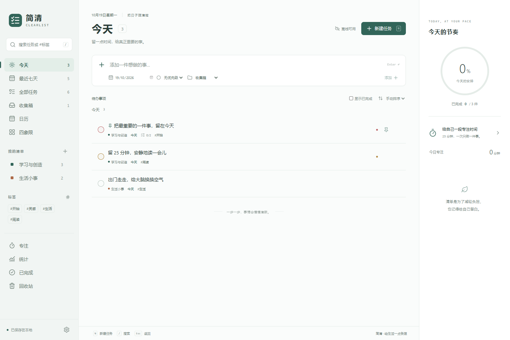
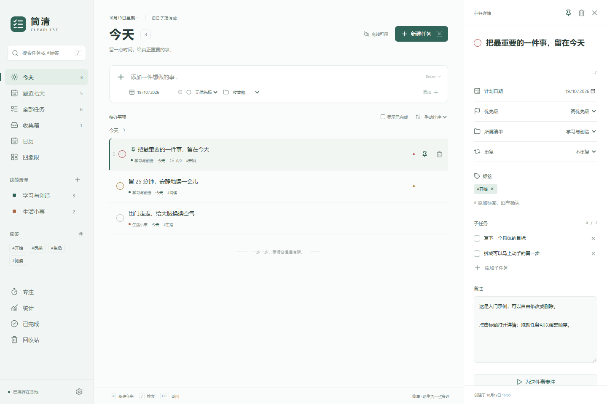
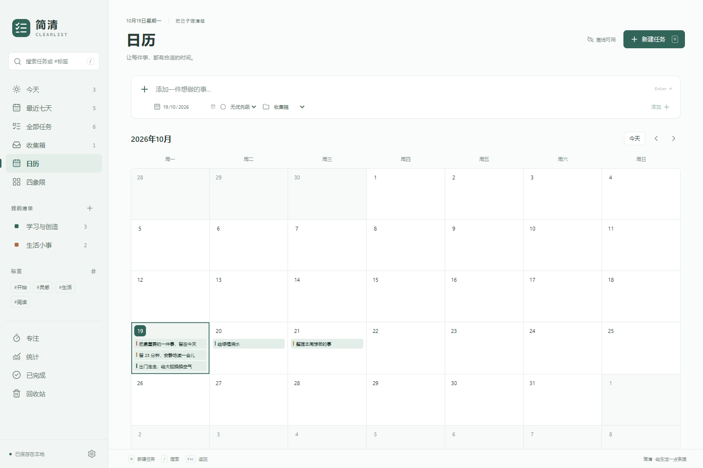
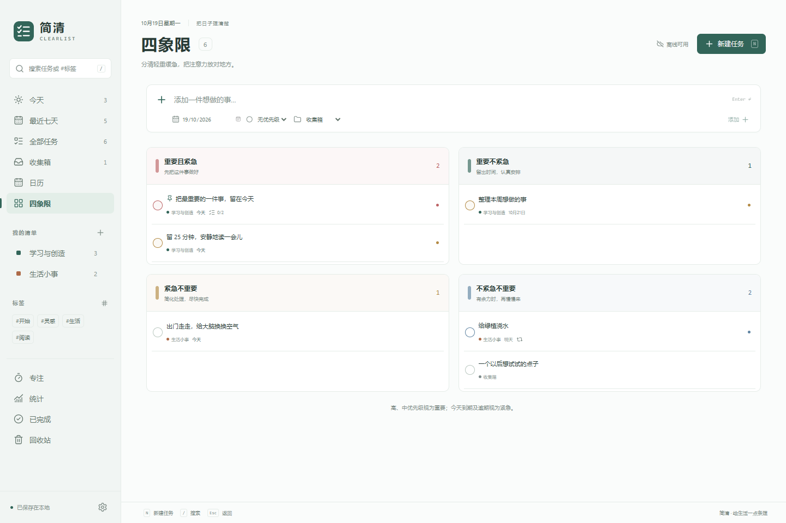
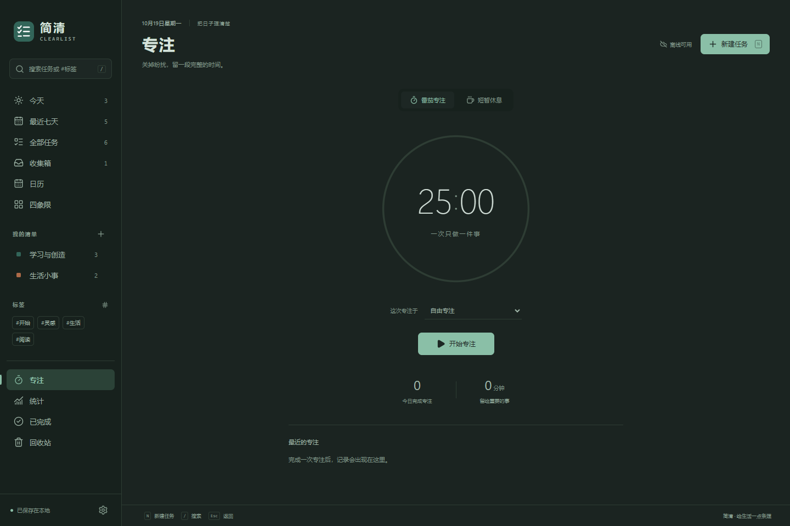

# 简清 · Clearlist

一个离线优先、无需账号的开源待办与专注工具。把想到的事记下来，安排到合适的日期，再留一段时间认真完成。

**Windows 桌面版 + 浏览器界面 · React / TypeScript / Electron · MIT**



## 现在可以做什么

- **管理待办**：今天（含逾期）、最近七天、全部任务和无日期收集箱。
- **整理任务**：彩色清单、标签、文字搜索、置顶、手动拖动排序，以及按日期或优先级排序。
- **细化行动**：备注、子任务、计划日期和四级优先级。
- **重复安排**：每天、每周、每月重复；完成后生成下一次，保留已完成记录。月底任务会保留原始日期锚点，例如 1 月 31 日 → 2 月 28 日 → 3 月 31 日。
- **换个角度看**：月历中拖动任务改期；四象限按优先级和到期状态划分。
- **专注与回顾**：关联任务的番茄计时、自定义专注和休息时长、暂停与恢复、完成记录，以及近七天任务和专注统计。
- **掌握自己的数据**：本地保存、上一版本备份、损坏恢复、JSON 导出和合并导入。
- **舒适地使用**：浅色、深色、跟随系统、键盘快捷键和窄屏布局。

初次启动为空白清单，可以选择添加入门示例。示例与正常任务一样，可以自由修改和删除。

<details>
<summary>更多界面</summary>









</details>

## 运行桌面版

Windows x64 便携包为 `Clearlist-0.1.0-Windows-x64.exe`，无需安装 Node.js。源码自行构建时，产物位于 `release/`。

便携包免安装，但用户数据保存在 `%APPDATA%\Clearlist`，不在 EXE 旁边。首次解压启动可能需要几秒钟。此预览版本尚未代码签名。

桌面应用关闭后计时截止时间会保留，下次打开时结算。应用完全关闭期间不会发送通知；通知是否显示还取决于 Windows 通知设置。

## 从源码开发

需要 Node.js 24 LTS 和 npm。所有依赖安装在当前项目内。

```powershell
npm ci
npm run dev
```

浏览器界面：

```powershell
npm run dev:web
```

打开 `http://127.0.0.1:5178`。浏览器使用自己的 localStorage，与桌面文件数据分开；清理网站数据前请先导出备份。该开发入口需要本地服务运行。

如果网络必须通过现有 HTTP(S) 代理下载 Electron，可仅对当前 PowerShell 进程设置其代理开关：

```powershell
$env:ELECTRON_GET_USE_PROXY = '1'
npm run dev
```

此开关只启用已有代理配置，不会修改系统代理。Electron 的下载器在首次启动或构建时准备对应运行时。

## 检查与打包

```powershell
npm run format:check
npm run check
npm test
npm run test:e2e
npm run test:desktop
npm run dist:win
npm run test:portable
```

浏览器测试优先使用 Windows 已有的 Edge；其他环境可运行项目本地的 `npx playwright install chromium`，或将 `CLEARLIST_BROWSER` 指向已有 Chromium 浏览器。桌面测试会在系统临时目录 `.agents/clearlist-*` 中创建隔离数据，结束后删除。

`test:portable` 需要先生成 Windows 便携包；它启动最终的单文件 EXE，通过仅本次测试使用的调试端口检查界面、任务写入和窗口关闭，结束后退出程序并清理隔离数据。

图标由 `scripts/make-icon.mjs` 独立绘制；如需修改并重新生成，运行 `node scripts/make-icon.mjs`。`npm run screenshots` 需要浏览器开发服务运行，截图使用独立浏览器上下文和示例任务。

## 数据与恢复

| 文件 / 操作                     | 含义                                                           |
| ------------------------------- | -------------------------------------------------------------- |
| `%APPDATA%\Clearlist\data.json` | 当前桌面数据                                                   |
| `data.backup.json`              | 上一次有效保存的数据                                           |
| `data.corrupt-*.json`           | 自动恢复时保留的损坏原文件                                     |
| 设置 → 导出 JSON                | 创建可携带的备份                                               |
| 设置 → 合并导入                 | 保留现有任务，合并有效备份；同 ID 任务使用更新时间较新的版本   |
| 无法读取数据 → 选择备份恢复     | 主数据与自动备份均不可读时，从手动导出的备份恢复，并保留原文件 |

数据不加密。需要保密时，请将导出文件和用户目录放在受保护的设备或磁盘上。`CLEARLIST_DATA_DIR` 可以为独立测试指定其他数据目录。

删除任务会先移入回收站，可以恢复。删除清单会把其中任务移到收集箱。合并导入保留当前外观、计时设置及正在运行的计时器。

## 首版范围

0.1.0 是可运行的离线初版，还没有多设备同步、Android/iOS 安装包、定时任务提醒、附件、自然语言日期识别、桌面小组件和自动更新。收集箱按“未安排日期”定义，不等同于默认清单。

原应用账号、云服务及数据库格式不兼容。此版本不读取或迁移原应用的个人任务数据。macOS / Linux 虽可复用源码，但本次只构建和检查了 Windows x64 桌面版；移动端仅检查了窄屏浏览器布局。

## 参考与许可证

本项目参考本机 Todo清单 3.14.2 发行包中的功能结构，通过只读静态检查确认任务、清单、标签、日历、重复任务和专注等工作流，然后独立实现代码、数据结构、界面、图标和文案。仓库不包含原发行包、提取源码、商标素材或服务凭据。

- [参考分析与功能映射](docs/design/reference-analysis.md)
- [存储、日期与计时设计](docs/design/storage.md)
- [验证记录](docs/verification.md)
- [贡献说明](CONTRIBUTING.md)

简清与 Todo清单及其开发者没有隶属关系。简清自身代码采用 [MIT](LICENSE)；第三方依赖与 Electron 运行时保留各自许可证。IPC 桥接和隔离设置参考 [Electron 官方进程通信文档](https://www.electronjs.org/docs/latest/tutorial/ipc) 与 [contextBridge 文档](https://www.electronjs.org/docs/latest/api/context-bridge)。
