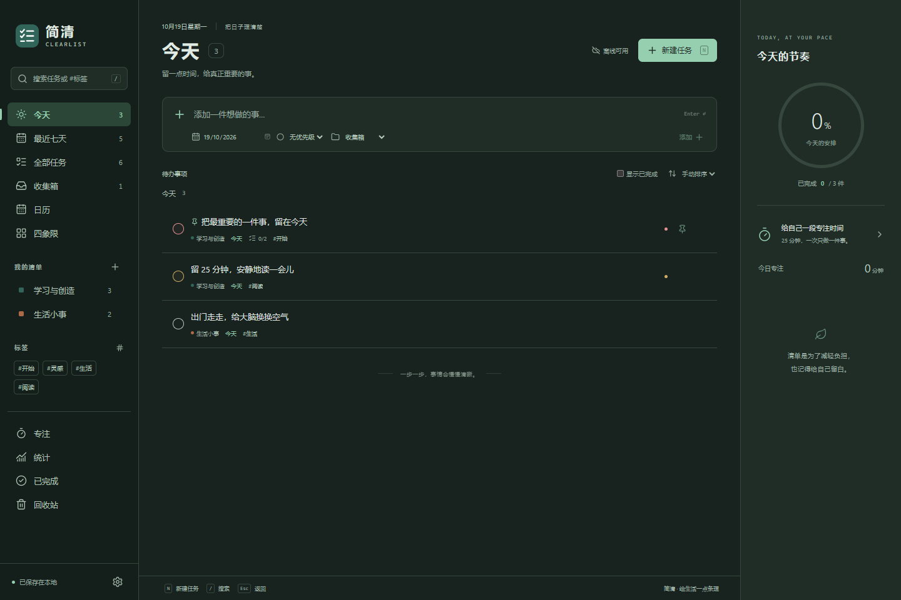
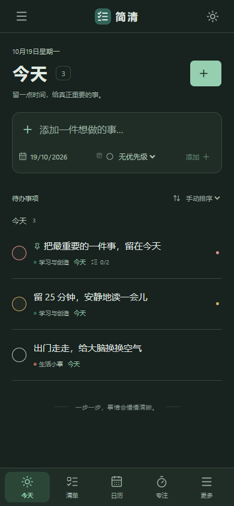

# 简清 · Clearlist

一个离线优先、无需账号的开源待办与专注工具。把想到的事记下来，安排到合适的日期，再留一段时间认真完成。

**Windows / macOS / Android · 离线数据 · 本机 AI API · MIT**

[下载安装包](https://github.com/AlexbeatsZ/clearlist/releases/latest) · [AI 接口文档](docs/api/README.md) · [版本记录](https://github.com/AlexbeatsZ/clearlist/releases) · [反馈问题](https://github.com/AlexbeatsZ/clearlist/issues)


## 现在可以做什么

- **管理待办**：今天（含逾期）、最近七天、全部任务和无日期收集箱。
- **整理任务**：彩色清单、标签、文字搜索、置顶、手动拖动排序，以及按日期或优先级排序。
- **细化行动**：备注、子任务、计划日期和四级优先级。
- **重复安排**：每天、每周、每月重复；完成后生成下一次，保留已完成记录。月底任务会保留原始日期锚点，例如 1 月 31 日 → 2 月 28 日 → 3 月 31 日。
- **换个角度看**：月历中拖动任务改期；四象限按优先级和到期状态划分。
- **专注与回顾**：关联任务的番茄计时、自定义专注和休息时长、暂停与恢复、完成记录，以及近七天任务和专注统计。
- **掌握自己的数据**：本地保存、上一版本备份、损坏恢复、JSON 导出和合并导入。
- **舒适地使用**：浅色、深色、跟随系统、键盘快捷键和窄屏布局。
- **随设备调整**：手机底部导航、全屏详情、系统返回与文件选择器；Mac 原生菜单与 Dock 行为。
- **交给 AI 整理**：Windows / macOS 提供需 Bearer 令牌的本机 REST API、OpenAPI 文档和自动读取本机配置的命令行客户端。界面与 AI 修改共享持久化队列，不同字段可并行合并。

初次启动为空白清单，可以选择添加入门示例。示例与正常任务一样，可以自由修改和删除。

<details>
<summary>更多界面</summary>






</details>

## 安装与运行

在 [GitHub Releases](https://github.com/AlexbeatsZ/clearlist/releases/latest) 下载对应设备的文件，无需安装 Node.js。源码自行构建时，产物位于 `release/`。

| 设备               | 0.2.0 文件                                             |
| ------------------ | ------------------------------------------------------ |
| Windows x64        | `Clearlist-0.2.0-Windows-x64.exe`，便携启动            |
| Mac Apple Silicon  | `Clearlist-0.2.0-macOS-arm64.dmg` 或 `.zip`，macOS 13+ |
| Mac Intel          | `Clearlist-0.2.0-macOS-x64.dmg` 或 `.zip`，macOS 13+   |
| Android 7.0 及以上 | `Clearlist-0.2.0-Android.apk`                          |

Windows 用户数据保存在 `%APPDATA%\Clearlist`，不在 EXE 旁边；首次便携解压启动可能需要几秒钟，程序尚无代码签名。Mac 将 DMG 中的应用拖到 Applications，或解压 ZIP 后运行；当前使用 ad-hoc 签名，未通过 Apple 公证，下载后的 Gatekeeper 体验尚待验证。Mac 数据位于 `~/Library/Application Support/Clearlist`；关闭窗口保留 Dock 和 AI 接口，Cmd+Q 退出应用。

Android 使用应用私有目录存储任务，设置中通过系统文件选择器导入或导出 JSON；发布 APK 使用固定本地签名密钥。各设备的离线数据独立，可用 JSON 转移；卸载或清除 Android 应用数据前请先导出。当前手机版为 Android，尚不提供 iOS 安装包。

计时截止时间会保留，恢复应用时结算。应用完全退出期间不会发送通知；桌面通知取决于系统设置，Android 当前不提供后台计时通知。

## 让 AI 操作

桌面版运行时，在设置的「AI 接口」中复制地址或访问令牌。本机默认地址为 `http://127.0.0.1:49721/api/v1`，端口冲突时自动调整。接口需要认证，固定监听本机，不对局域网开放。

源码目录自带客户端，自动读取当前用户的地址和令牌：

```sh
npm run ai -- GET "/tasks?view=today"
npm run ai -- POST /tasks --body-file task.json
npm run ai -- POST /tasks/TASK_ID/complete
```

`task.json` 可写为 `{"title":"整理实验记录","priority":2}`。任务、清单、标签、子任务、专注、统计、导入导出等端点及并发处理见 [AI 使用说明](docs/api/README.md) 和 [OpenAPI](docs/api/openapi.json)。Android 当前不运行 HTTP 服务。

## 从源码开发

需要 Node.js 24 LTS 和 npm。所有依赖安装在当前项目内。

```powershell
git clone https://github.com/AlexbeatsZ/clearlist.git
cd clearlist
npm ci
npm run dev
```

浏览器界面：

```powershell
npm run dev:web
```

打开 `http://127.0.0.1:5178`。浏览器使用自己的 localStorage，与桌面文件数据分开；清理网站数据前请先导出备份。该开发入口需要本地服务运行。

如果网络必须通过现有 HTTP(S) 代理下载 Electron，可仅对当前 PowerShell 进程设置其代理开关：

```powershell
$env:ELECTRON_GET_USE_PROXY = '1'
npm run dev
```

此开关只启用已有代理配置，不会修改系统代理。Electron 的下载器在首次启动或构建时准备对应运行时。

## 检查与打包

```powershell
npm run format:check
npm run check
npm test
npm run test:e2e
npm run test:desktop
npm run test:api
npm run dist:win
npm run test:portable
npm run dist:mac
npm run dist:android
```

浏览器测试优先使用 Windows 已有的 Edge；其他环境可运行项目本地的 `npx playwright install chromium`，或将 `CLEARLIST_BROWSER` 指向已有 Chromium 浏览器。桌面测试会在系统临时目录 `.agents/clearlist-*` 中创建隔离数据，结束后删除。

`test:portable` 需要先生成 Windows 便携包；它启动最终的单文件 EXE，通过仅本次测试使用的调试端口检查界面、任务写入和窗口关闭，结束后退出程序并清理隔离数据。

图标由 `scripts/make-icon.mjs` 独立绘制；如需修改并重新生成，运行 `node scripts/make-icon.mjs`。`npm run screenshots` 需要浏览器开发服务运行，截图使用独立浏览器上下文和示例任务。

`dist:mac` 在 Mac 上构建当前架构，`npm run dist:mac -- x64` 可指定 Intel；GitHub Actions 分别在 arm64 和 Intel runner 构建。`dist:android` 需要已有 Android SDK 与 Java 21，可用 `CLEARLIST_JAVA_HOME` 指定项目使用的 Java；脚本优先使用已有 Android Studio JBR。首次发布构建在忽略的 `.local/android-signing/` 生成私钥与密码，务必自行安全备份以支持以后覆盖升级，绝不可提交或公开。CI 仅生成调试 APK，不使用发布私钥。

## 数据与恢复

| 文件 / 操作                     | 含义                                                           |
| ------------------------------- | -------------------------------------------------------------- |
| `%APPDATA%\Clearlist\data.json` | 当前桌面数据                                                   |
| `data.backup.json`              | 上一次有效保存的数据                                           |
| `data.corrupt-*.json`           | 自动恢复时保留的损坏原文件                                     |
| 设置 → 导出 JSON                | 创建可携带的备份                                               |
| 设置 → 合并导入                 | 保留现有任务，合并有效备份；同 ID 任务使用更新时间较新的版本   |
| 无法读取数据 → 选择备份恢复     | 主数据与自动备份均不可读时，从手动导出的备份恢复，并保留原文件 |

数据不加密。需要保密时，请将导出文件和用户目录放在受保护的设备或磁盘上。`CLEARLIST_DATA_DIR` 可以为独立测试指定其他数据目录。

删除任务会先移入回收站，可以恢复。删除清单会把其中任务移到收集箱。合并导入保留当前外观、计时设置及正在运行的计时器。

## 当前范围

0.2.0 提供 Windows、Mac 与 Android 包、完整暗色主题和桌面 AI API。当前还没有多设备自动同步、iOS 安装包、定时任务提醒、附件、自然语言日期识别、桌面小组件和自动更新。收集箱按“未安排日期”定义，不等同于默认清单。

原应用账号、云服务及数据库格式不兼容。此版本不读取或迁移原应用的个人任务数据。各平台构建、自动化界面与实体设备的检查范围分别记录在 [验证记录](docs/verification.md)。

## 参考与许可证

本项目参考本机 Todo清单 3.14.2 发行包中的功能结构，通过只读静态检查确认任务、清单、标签、日历、重复任务和专注等工作流，然后独立实现代码、数据结构、界面、图标和文案。仓库不包含原发行包、提取源码、商标素材或服务凭据。

- [参考分析与功能映射](docs/design/reference-analysis.md)
- [存储、日期与计时设计](docs/design/storage.md)
- [多平台、主题与打包](docs/design/platforms.md)
- [AI API 与并发设计](docs/design/api.md)
- [验证记录](docs/verification.md)
- [贡献说明](CONTRIBUTING.md)

简清与 Todo清单及其开发者没有隶属关系。简清自身代码采用 [MIT](LICENSE)；第三方依赖与 Electron 运行时保留各自许可证。IPC 桥接和隔离设置参考 [Electron 官方进程通信文档](https://www.electronjs.org/docs/latest/tutorial/ipc) 与 [contextBridge 文档](https://www.electronjs.org/docs/latest/api/context-bridge)。
